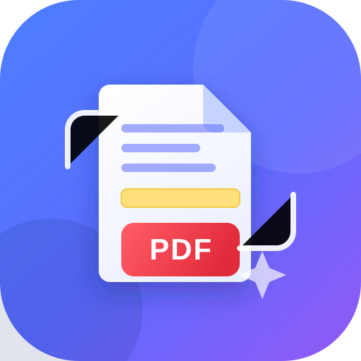
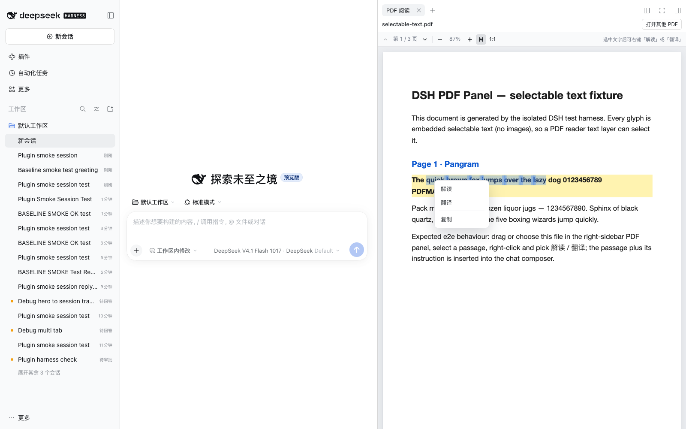
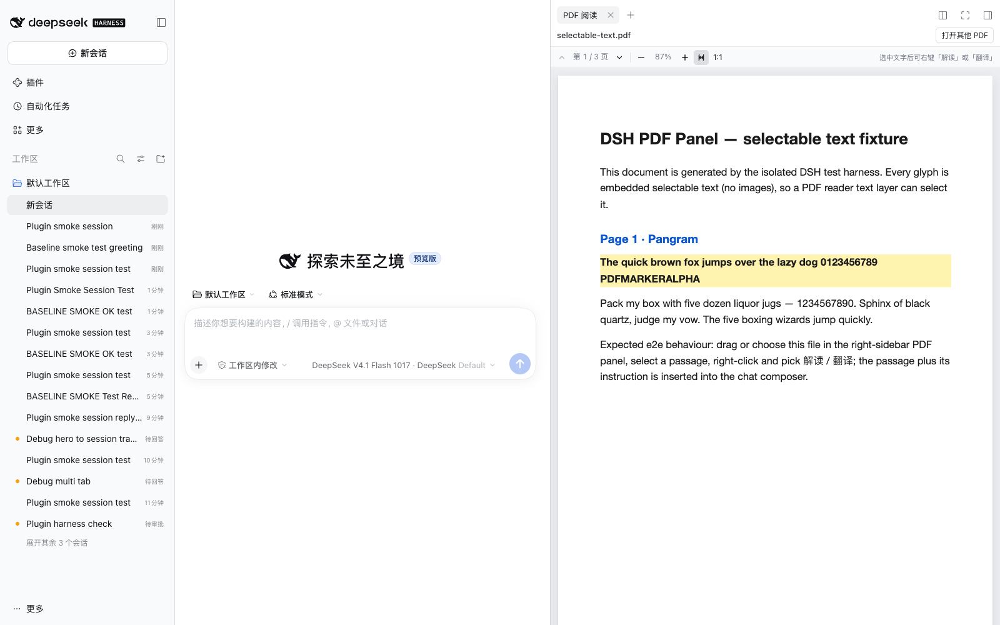
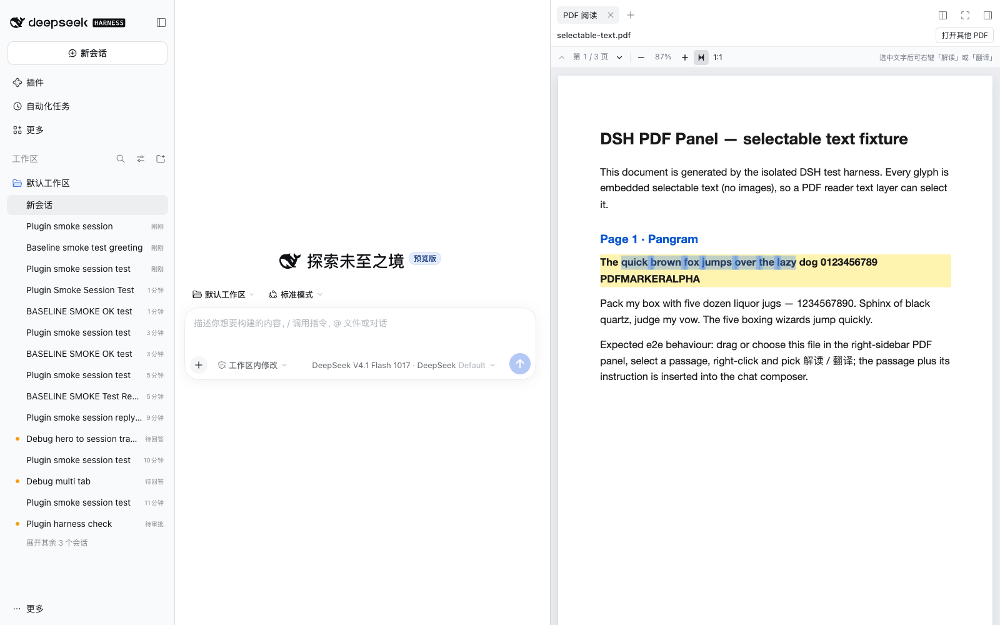
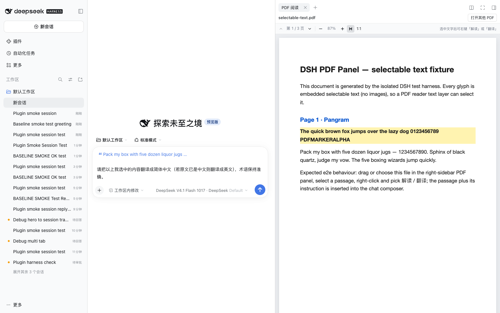
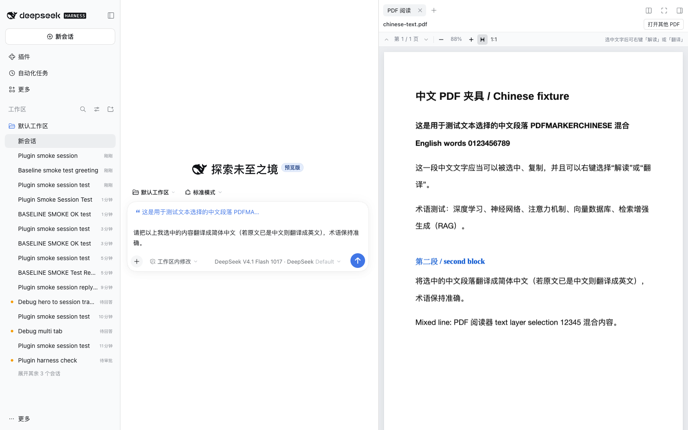

# dsh-pdf-panel · DSH 右侧栏 PDF 阅读

<p align="center">
  
</p>

<p align="center">
  <b>在 DeepSeek Harness 右侧栏阅读 PDF：拖入即预览，选中文字右键「解读」「翻译」，原文与提示词自动进入左侧会话输入框。</b>
</p>

<p align="center">
  <a href="LICENSE"></a>
  <a href="https://www.npmjs.com/package/dsh-pdf-panel"></a>
  
</p>

<!-- 被 dsh-plugin.org 收录后取消注释，并把链接换成你的详情页 slug
<p align="center">
  <a href="https://dsh-plugin.org/plugins/inceCheng/dsh-pdf-panel"></a>
</p>
-->



## 一句话价值

安装后，DSH 右侧栏多出一个 PDF 阅读面板：把 PDF 从桌面/访达拖进去即可预览；选中任意段落右键「解读」「翻译」，选中的原文会以引用块形式连同默认提示词直接写进左侧会话输入框，省去复制粘贴和手动组织提示词的步骤。

## 功能

- **右侧栏入口**：会话标题栏右侧的 PDF 图标按钮；右侧栏引导页的「PDF 阅读」卡片。
- **拖拽即预览**：从桌面、访达或任何目录把 `.pdf` 拖进面板即可渲染；也支持「选择 PDF 文件」。
- **完整 PDF 阅读**：PDF.js 渲染、多页懒加载、适合宽度 / 缩放 / 实际大小、上下翻页、当前页码。
- **可选中文本**：与画布对齐的文本层，支持鼠标拖选、跨页选择、`⌘C` 复制。
- **右键动作**：选中文字后右键出现「解读 / 翻译 / 复制」：
  - 解读 → 引用原文 + `请解读以上我选中的内容：说明它的含义、背景和关键概念，并结合上下文指出我可能忽略的要点。`
  - 翻译 → 引用原文 + `请把以上我选中的内容翻译成简体中文（若原文已是中文则翻译成英文），术语保持准确。`
- **不污染会话附件**：拖进 PDF 面板的文件只用于预览，不会同时变成聊天附件。
- 中文 / 英文界面文案；浅色 / 深色主题；PDF 解析在独立 Web Worker 中完成，首屏只加载 13 KB 插件外壳。

## 截图

| 预览 PDF | 选中文字右键 |
| --- | --- |
|  |  |

| 解读 → 输入框 | 翻译 → 输入框 |
| --- | --- |
|  |  |

中文 PDF 的选中与翻译：

## 安装

要求：**DeepSeek Harness 0.2.x**（在 0.2.2-rc.1 上实测；Web 版与桌面 App 均可）。

### 1. npm 安装（推荐）

```sh
dsh plugin --profile web add dsh-pdf-panel
```

桌面 App：左侧栏 **插件 → 添加插件 → 输入 `dsh-pdf-panel` → 安装 → 立即启用**。
装完刷新页面（桌面端 `⌘R`）即可看到入口。

### 2. 源码安装（不依赖 npm）

```sh
dsh plugin --profile web add github:inceCheng/dsh-pdf-panel
```

仓库已提交构建产物 `lib/`，源码安装无需本地构建、无需 Node.js。

### 3. 本地目录安装（开发调试）

```sh
dsh plugin --profile web add /path/to/dsh-pdf-panel
```

> 桌面 App 的 `desktop` profile 由 App 独占管理，`dsh` CLI 会提示 `profile "desktop" is managed exclusively by the Electron application`；请使用 App 内的「插件 → 添加插件」（支持包名、Git 地址、tarball 绝对路径或本地目录），或者参考下文「本地安装进桌面 profile」。

<details>
<summary>本地安装进桌面 profile（可选）</summary>

```sh
# 用 App 自带运行时把仓库/目录链接进 profile，并把 bundle 名追加到 dsh.profile.bundles
cd "$HOME/.dsh/profiles/desktop"
<dsh-runtime>/dependencies/node/bin/node <dsh-runtime>/dependencies/pnpm/bin/pnpm.cjs \
  add --ignore-scripts "link:/path/to/dsh-pdf-panel"
# 然后编辑 package.json，在 dsh.profile.bundles 末尾加入 "dsh-pdf-panel"，刷新页面
```

</details>

## 使用

1. 打开任意会话，点会话标题栏右侧的 PDF 图标（或右侧栏「PDF 阅读」卡片）打开面板。
2. 把 PDF 从桌面 / 访达拖进右侧面板，或点「选择 PDF 文件」。
3. 在 PDF 里拖选想看的段落 → 右键 → **解读 / 翻译 / 复制**。
4. 原文以引用形式出现在左侧输入框，并带上默认提示词；可直接发送，也可先修改提示词。

默认提示词在 [`src/client/locales.ts`](src/client/locales.ts) 的 `explainInstruction` / `translateInstruction`，修改后 `npm run build` 并刷新页面即可生效。

## 兼容性与运行要求

| 项 | 说明 |
| --- | --- |
| DSH 版本 | `>=0.2.0 <0.3.0`（`package.json` 的 `engines.dsh`；在 0.2.2-rc.1 实测） |
| 平台 | Web 版 / 桌面 App（macOS 实测；客户端为浏览器插件，无平台相关依赖） |
| 额外运行环境 | 用户侧无需 Node.js / pnpm；PDF 解析全部在本机浏览器与 Web Worker 内完成 |
| 权限 / 外部服务 | Host 侧为空实现（`lib/index.js` 仅导出空 `apply()`）；不发起任何网络请求；PDF 不上传、不离开本机 |
| 已知限制 | 每个右侧栏标签页同时预览一个 PDF（打开第二个会替换）；纯扫描件没有文字层，无法选中文字 |

## 开发

```sh
npm install
npm run build        # 生成 lib/client.js（插件外壳）与 lib/client.pdf.js（懒加载 PDF.js chunk）
npm run typecheck    # tsc --noEmit
```

结构：

```
dsh-pdf-panel/
├── package.json          # dsh.bundle（配置层）+ dsh.client（Web 客户端包）
├── cordis.patch.yml      # 向 profile 插入一条 Loader 行
├── build.mjs             # esbuild 构建：主 bundle + 懒加载 chunk + PDF.js worker/字体/CMap 内联
├── src/
│   ├── host/index.js     # Host Loader 入口（无宿主行为）
│   └── client/
│       ├── index.tsx     # 注册右侧栏 tab 类型、引导卡、标题栏入口
│       ├── locales.ts    # 中英文文案 + 默认提示词
│       ├── panel/        # 面板外壳：拖拽、文件读取、提示词插入
│       └── pdf/          # 懒加载 chunk：PDF.js 渲染、文本层、右键菜单（自包含）
├── lab/                  # 独立浏览器验证 harness（不参与发布）
├── docs/screenshots/     # README 截图
└── lib/                  # 构建产物（已提交，供源码安装直接使用）
```

- 主 bundle 仅约 13 KB；PDF.js 6 及同版本 cmaps / standard fonts / wasm 被内联进 6.2 MiB 懒加载 chunk，由 DSH 模块加载器的 `require.async('./client.pdf.js')` 在第一次打开 PDF 时加载。
- 独立验证：`cd lab && npm install && npm test`（用系统 Chrome 跑渲染、文本选择、右键菜单与重新加载等 54 项检查）。

## English

**DSH PDF Reader** — a right-sidebar PDF panel for DeepSeek Harness. Drag a PDF from Finder/your desktop into the panel, select any passage, and right-click **Explain / Translate** to insert the quoted passage plus a ready-to-send prompt into the chat composer. Supports multi-page lazy rendering, selectable text layers, zoom/fit-width, light/dark themes, and Chinese/English UI. Works with DSH `0.2.x`; everything is parsed locally in a Web Worker — no network requests, no uploads.

```sh
dsh plugin --profile web add dsh-pdf-panel
```

## 许可证

[MIT](LICENSE)。构建产物内嵌的 PDF.js（Mozilla）以 Apache-2.0 分发，其许可声明保留在 `lib/client.pdf.js` 文件头。
